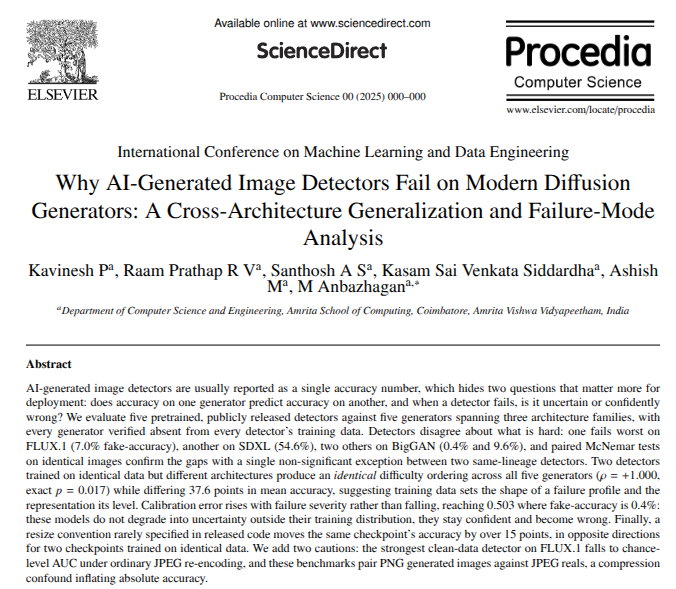

# Blindspot



**Why deepfake detectors fail on modern diffusion generators.**

BlindSpot studies how well existing fake-image detectors generalize once you move
past the generators they were originally evaluated on. Most published detectors
report strong numbers on GAN-era fakes (ProGAN, BigGAN, StyleGAN); we test the same
detectors, unmodified, against a spread of generators from GAN-era to 2025-era
diffusion transformers (DiT) — BigGAN, GLIDE, Flux, SD3, and SDXL — and measure
where accuracy actually holds up versus where it quietly collapses.

## What's in this repo

```
BlindSpot/
├── paper/                      # paper source + all generated figures/tables
│   ├── paper_draft.tex         # original ICMLDE submission
│   ├── predictions/            # per-image scores behind every number (see its README)
│   ├── review_additions/       # outputs of the revision-round experiments
│   ├── universalfakedetect/    # per-detector results: accuracy, confusion
│   ├── npr/                    #   matrices, score distributions, spectra
│   ├── genimagepp_clip_baseline/
│   ├── genimagepp_clip_lora/
│   ├── shared_spectra/         # generator-level frequency analysis (not detector-specific)
│   ├── comparison/             # cross-detector summary once all runs are in
│   └── scripts/                # reusable, detector-agnostic analysis scripts
├── genimagepp_detectors/
│   ├── run_resnet_baseline.py  # ResNet baseline detector
│   ├── run_clip_baseline.py    # CLIP linear-probe baseline
│   ├── run_clip_lora.py        # CLIP-LoRA, adversarially hardened variant
│   ├── attack_code/            # adversarial robustness evaluation
│   └── predictions_*.csv       # per-generator, per-detector raw predictions
├── ICMLDE_revised/             # revised manuscript + reviewer response (LaTeX + PDF)
├── NPR-DeepfakeDetection/       # baseline (submodule, chuangchuangtan/NPR-DeepfakeDetection)
├── UniversalFakeDetect/         # baseline (submodule, WisconsinAIVision/UniversalFakeDetect)
├── paper.txt                   # working notes on framing/results
└── Court_room_videos.txt       # misc reference links (unrelated to the detection work)
```

## Detectors evaluated

| Detector | Type | Source |
|---|---|---|
| UniversalFakeDetect | CLIP ViT-L/14 linear probe (Ojha et al., CVPR 2023) | submodule |
| NPR | Neighboring Pixel Relationships (Tan et al.) | submodule |
| CLIP baseline | CLIP linear probe, trained on modern DiT generators | `genimagepp_detectors/run_clip_baseline.py` |
| CLIP-LoRA | CLIP-LoRA, adversarially/OOD-hardened variant | `genimagepp_detectors/run_clip_lora.py` |
| ResNet baseline | Standard CNN baseline | `genimagepp_detectors/run_resnet_baseline.py` |

## Generators evaluated

GAN-era: **BigGAN**. U-Net diffusion: **GLIDE**, **SDXL**. Diffusion transformers:
**Flux**, **SD3**.

Real images come from GenImage's ImageNet-derived splits, not COCO: BigGAN and
GLIDE are each evaluated against their own paired real split, while Flux, SD3 and
SDXL have no shipped reals and are scored against GenImage's BigGAN-subset real
training pool (~162k ImageNet images, disjoint from BigGAN's own evaluation
split). Section 3.2 of the paper explains why that asymmetry is forced by the
datasets.

Each detector folder under `paper/` reports, per generator: accuracy/AUC,
confusion matrices, score distributions, and frequency-domain spectra (high-pass
vs. low-pass log-energy gap) — plus a folder of failure examples where a detector
called a fake image confidently real.

## What's intentionally not in this repo

Two datasets and one set of model checkpoints are excluded via `.gitignore`
because they're far too large for git (tens of gigabytes) and, in COCO's case,
freely available from the original source rather than something to vendor here:

- `genimagepp/` — the generated-image sets (SDXL/SD3/Flux), ~43GB
- `real_coco/` — MS COCO val2017 + annotations, ~2.7GB, download from
  [cocodataset.org](https://cocodataset.org)
- `genimagepp_detectors/attack_code/weights/` — trained detector checkpoints, ~2.4GB

## Baselines

`NPR-DeepfakeDetection` and `UniversalFakeDetect` are included as git submodules
pointing at their original repositories, rather than vendored copies, since they're
published baselines from other research groups, not original contributions of this
project. Run `git submodule update --init --recursive` after cloning to pull them.

## Paper

Submitted to **ICMLDE 2026** (International Conference on Machine Learning and
Data Engineering) and revised after review.

| | |
|---|---|
| Revised manuscript | [`ICMLDE_revised/ICMLDE_manuscript.pdf`](ICMLDE_revised/ICMLDE_manuscript.pdf) |
| Response to reviewers | [`ICMLDE_revised/ICMLDE_response.pdf`](ICMLDE_revised/ICMLDE_response.pdf) |
| Both in one file (what was submitted) | [`ICMLDE_revised/ICMLDE_revised.pdf`](ICMLDE_revised/ICMLDE_revised.pdf) |
| Original submission | [`paper/paper_draft.tex`](paper/paper_draft.tex) |

## Reproducing the numbers

Every table and the figure are computed from the per-image score files in
[`paper/predictions/`](paper/predictions/), which hold one row per image per
detector. Nothing is transcribed by hand.

```
git clone --recurse-submodules https://github.com/MogSquad-FinalYear/BlindSpot
cd BlindSpot
pip install numpy scipy scikit-learn matplotlib

python paper/scripts/full_metrics_and_tests.py        # Tables 3, 4, 5
python paper/scripts/ensemble_and_reliability.py      # Table 6, Figure 1
python paper/scripts/preprocessing_and_jpeg_summary.py # Table 7
python paper/scripts/compression_conditions.py        # Table 8
```

These read score files and need no GPU, no checkpoints and no image datasets.
Paths resolve against the repository, so a clean clone works unedited; set
`BLINDSPOT_PREDICTIONS` or `BLINDSPOT_OUT` to redirect input or output.

Re-running inference from scratch is a different matter and does need the
checkpoints and image sets excluded below. The driver scripts that produced
every cell are `genimagepp_detectors/run_all_full.sh`,
`NPR-DeepfakeDetection/run_all_full.sh`, `UniversalFakeDetect/run_all_full.sh`
and `paper/scripts/run_review_additions.sh`; dataset and checkpoint locations
are set in variables at the top of each.
